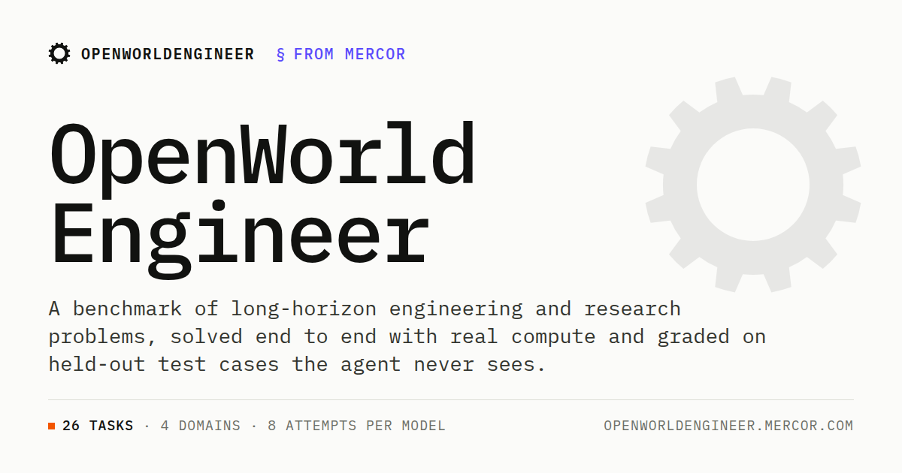

<p align="center">
  <a href="https://openworldengineer.mercor.com">
    
  </a>
</p>

# OpenWorld-harness

OpenWorld-harness is the agent harness behind
[OpenWorldEngineer](https://openworldengineer.mercor.com), a benchmark of long-horizon
engineering and research tasks. It is an extension of [Proximus](https://github.com/Proximal-Labs/proximus) and is a coding agent packaged as an external agent for
[Harbor](https://pypi.org/project/harbor/): it runs a LiteLLM tool loop on the host and
acts in the sandbox only through Harbor's environment interface, so it works with any
Harbor environment (Docker, Modal, ...).

- **Leaderboard and trajectories:** [openworldengineer.mercor.com](https://openworldengineer.mercor.com)
- **Tasks:** [mercor/OpenWorldEngineer](https://huggingface.co/datasets/mercor/OpenWorldEngineer) on Hugging Face
- **Docs:** [usage](docs/usage.md), [web search](docs/web-search.md),
  [reproducing OpenWorldEngineer runs](docs/reproducing-openworldengineer.md)

## Features

- Submissions are Git commits in the workspace. The model's newest recorded submission
  is graded, and unsaved work is snapshotted at exit.
- Paces the run against a time budget and compacts the conversation near the context
  limit, keeping the model's own notes.
- Works with any LiteLLM model. Provider keys stay on the host and are blanked inside
  the sandbox.
- Optional `web_search` and `web_fetch` over the web as
  [Exa](https://exa.ai/docs/search/snapshot) stored it on a fixed date.
- Built for runs of many hours: it ends the run cleanly when the sandbox dies, enforces
  the sandbox's memory limit, kills a timed-out command with everything it started, and
  retries provider failures.

## Install

Requires Python 3.12+ and Harbor 0.23.0.

```sh
uv pip install "openworld-harness @ git+https://github.com/mercor-code-envs/OpenWorld-harness@v0.0.1"
```

## Quick start

```sh
export ANTHROPIC_API_KEY=...
harbor run -p path/to/task --agent openworld_harness:OpenWorldHarness \
  --model anthropic/claude-opus-5 --ak time_budget_sec=7200
```

`harbor agent schema openworld_harness:OpenWorldHarness` lists every option, and
[examples/agent.yaml](examples/agent.yaml) shows a job-config fragment. Keep Harbor's
hard agent timeout above `time_budget_sec`, so the exit submit can finish
([usage](docs/usage.md#how-it-works)). Never pass keys with `--ak`: Harbor saves agent
options in its job files.

## Reproducing OpenWorldEngineer runs

[examples/openworldengineer](examples/openworldengineer) writes Harbor jobs with the
leaderboard's settings: its system prompt, options, time budgets, offline sandbox, web
snapshot (2026-10-01) and 8 attempts per task.

```sh
git clone https://github.com/mercor-code-envs/OpenWorld-harness && cd OpenWorld-harness
uv sync --locked && . .venv/bin/activate
sh scripts/build-static-git.sh static-git/git   # for task images without git
export ANTHROPIC_API_KEY=... EXA_API_KEY=...
python examples/openworldengineer/make_jobs.py --model anthropic/claude-opus-5 \
  --reasoning-effort max --static-git static-git/git --env modal --out owe-runs \
  path/to/OpenWorldEngineer/tasks/*
```

It prints a `harbor run` command for each task. The
[guide](docs/reproducing-openworldengineer.md) covers what the jobs contain, GPU and
ungraded tasks, and what the leaderboard did that this does not.

## Development

```sh
uv sync --locked
uv run pytest -q
uv run --locked ruff check src tests scripts examples
uv run --locked ruff format --check src tests scripts examples
uv build && uv run python scripts/verify_wheel.py dist/openworld_harness-*.whl
```

The tests are offline (fake providers, temporary Git repositories). `verify_wheel.py`
reruns them against the installed wheel outside the checkout.

## License

Apache-2.0. OpenWorld-harness is a modified version of
[Proximus](https://github.com/Proximal-Labs/proximus) by Proximal AI, Inc.; see
[LICENSE](LICENSE) and [NOTICE](NOTICE).
